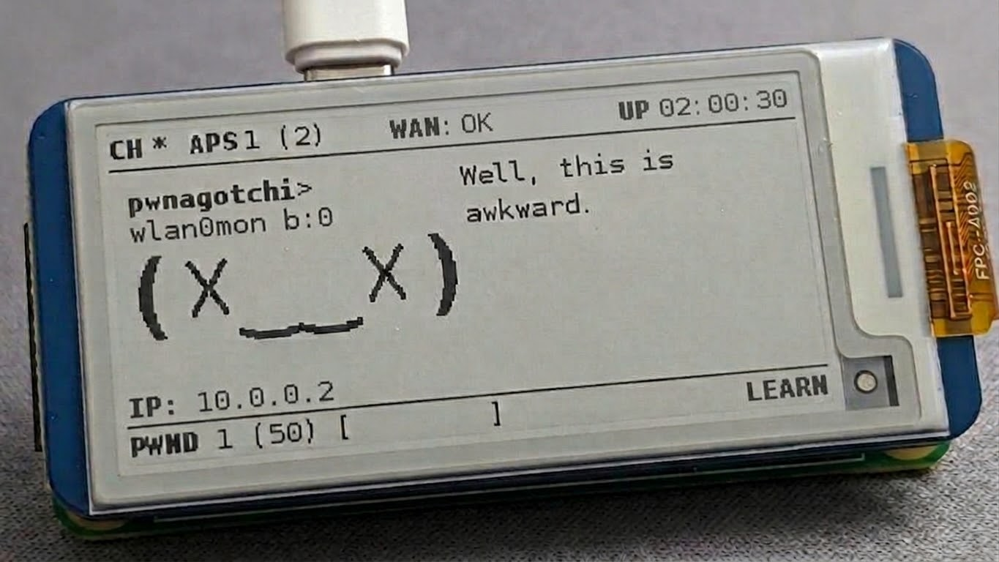

# Pwnagotchi 32-bit modern PyTorch generation
> Overall, there are too many changes in this fork to feasibly maintain a Markdown file describing the features; instead, a single [`ENTRY.md`](ENTRY.md) file is provided, outlining the initial setup and key features. If questions remain after reviewing the contents of this branch, answers may be found in the [sb2.7](https://github.com/flippedgannet/pwnagotchi-ai32/tree/sb2.7) branch.

## Pwnagotchi
 [Pwnagotchi](https://pwnagotchi.ai/) is an [A2C](https://hackernoon.com/intuitive-rl-intro-to-advantage-actor-critic-a2c-4ff545978752)-based "AI" leveraging [bettercap](https://www.bettercap.org/) that learns from its surrounding WiFi environment to maximize the crackable WPA key material it captures (either passively, or by performing authentication and association attacks). This material is collected as PCAP files containing any form of handshake supported by [hashcat](https://hashcat.net/hashcat/), including [PMKIDs](https://www.evilsocket.net/2019/02/13/Pwning-WiFi-networks-with-bettercap-and-the-PMKID-client-less-attack/), full and half WPA handshakes.Instead of merely playing [Super Mario or Atari games](https://becominghuman.ai/getting-mario-back-into-the-gym-setting-up-super-mario-bros-in-openais-gym-8e39a96c1e41?gi=c4b66c3d5ced) like most reinforcement learning-based "AI" *(yawn)*, Pwnagotchi tunes its parameters over time to **get better at pwning WiFi things to** in the environments you expose it to.

Multiple units within close physical proximity can "talk" to each other, advertising their presence to each other by broadcasting custom information elements using a parasite protocol [@evilsocket](https://x.com/evilsocket) built on top of the existing dot11 standard. Over time, two or more units trained together will learn to cooperate upon detecting each other's presence by dividing the available channels among them for optimal pwnage.

*pwnagotchi32-sb  
*[pwnagotchi-ai32](https://github.com/flippedgannet/pwnagotchi-ai32/) and the original account have been flagged, which prevents using Git to push a major update; therefore, the project is moving to this account.*

## This fork
### Initially the fork was based on Debian Buster, but we have now switched to Raspberry Pi OS 11 (Bullseye). 
### Why not Bookworm or newer?
Choosing **Debian 11 (Bullseye)** over newer releases like Bookworm balances modern ecosystem support with core system stability. While *Buster* is now legacy, *Bullseye* remains highly relevant and fully capable of supporting the Pwnagotchi ecosystem without introducing unnecessary architectural overhead.

The primary advantages of this choice include:
* **Deprecation of PEP 668 Strictness:** Starting with Bookworm, Debian enforces PEP 668 (`externally-managed-environment`), which mandates Python virtual environments (venvs) or `pipx` for package management. For an embedded system like Pwnagotchi, this introduces significant friction in automation scripts, dependency management, and user interaction. Bullseye allows direct global package management where isolation overhead provides no real benefit.
* **Architectural Continuity:** Bullseye maintains backward compatibility and architectural alignment with earlier builds. This drastically simplifies the porting and maintenance of existing plugins, custom drivers, and low-level patches (such as Nexmon or display drivers) without breaking core system paths.
* **Streamlined UX:** Users and developers benefit from a predictable environment. You get a modern enough user-space without the complexity of modern Linux containerization/isolation paradigms, ensuring a lower barrier to entry and easier troubleshooting.

### Advantages and key differences compared to previous versions based on Buster:
**The main difference is Stable Baselines3.** In general, all system components have been reworked, but the key highlight is the switch to **PyTorch**. You can now stop the training loop without restarting the service and switch the *LERAN/EVAL* mode to *AUTO* on the fly. The algorithm itself kicks in starting from the second epoch, while the dependency bootstrapping happens rapidly right at the beginning - before the first epoch even starts; additionally, the AI now pauses when in the "bored" state, rather than only at "sad" or worse. There are many other differences, but the bottom line is that the experience is now much more convenient and efficient for the user, with operations feeling smoother and more cohesive. Handling **SIGTERM** is faster and simpler, as we no longer need to interrupt sessions by restarting the process; instead, we simply back up the *"brain"* files in certain cases and shut down the processes safely.

New Python, new dependency versions, a more convenient and simpler build process (still under development).
 
*Most of the new display drivers have not been tested, and some were sourced from various community images.*

### AI is just useless junk that hogs memory and CPU resources, killing all capture efficiency. Right??
**Yes, but not quite. So why did I do it? In short - just for skills training.**

Here, the AI is presented in a completely different, multifunctional, fast and efficient form that the original 32-bit Pwnagotchi has never seen. Modern forks completely strip out the AI, replacing it with a lightweight, efficient **"auto-tune"** algorithm. I could do the same, but I’m working on this project purely out of interest and curiosity - to develop my own skills. It’s far more interesting to watch a real AI evolve and learn. After all, the AI is the heart of the original Pwnagotchi by [evilsocket](https://github.com/evilsocket); it shouldn't be dismissed as just a silly, misguided experiment.

By the way, maybe if you collect 200,000+ handshakes, the AI will become a WPA god. Though, in all likelihood, its brain would just start to degenerate. Still, I recommend giving it a try.

## Credits
`pwnagotchi` originally created by **[@evilsocket](https://x.com/evilsocket)**
* **[jayofelony](https://github.com/jayofelony)** - created numerous other projects useful to the Pwnagotchi community, and I have incorporated many implementations from all of them into my own fork
* **[experiment18a](https://github.com/ex18a)** - the creator of the pwnagotchi64 AI image, from whom I drew numerous ideas

Other key community members whose projects helped shape the image: **[wsvdmeer](https://github.com/wsvdmeer)**, **[sniffleupagus](https://github.com/Sniffleupagus)**.
  
 If I used your code, script, or anything else without crediting you, and you would like to be credited, please open an issue so I can acknowledge your authorship here.

 **It is released under the **GPL3 license.***
